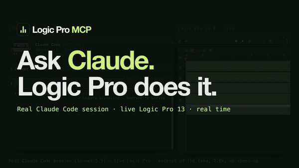

# Logic Pro MCP

A local [Model Context Protocol](https://modelcontextprotocol.io) server that lets an MCP client (Claude Code, Claude Desktop, Cursor, Codex, VS Code and others) drive Logic Pro on macOS: transport, tracks, mixer, MIDI, plug-ins, navigation, project lifecycle and audio-file analysis. It talks to the client over stdio, and every write is checked against what Logic reports back.

<p align="center">
  <a href="https://claude.com/contact-sales/claude-for-oss"></a>
  
</p>

<p align="center">
  <a href="docs/media/logic-pro-mcp-demo.mp4"></a>
  <br /><sub>A real Claude Code session, live on Logic Pro 13.0 with v3.19.0, at 1.0x. Click for the <a href="docs/media/logic-pro-mcp-demo.mp4">2 min film with sound</a>.</sub>
</p>

[Install](#install) · [Register a client](#register-with-an-mcp-client) · [Permissions](#permissions) · [Tools](#tools-and-operations) · [Safety model](#safety-model) · [What changed in 3.19.0](#what-changed-in-3190) · [Demo](docs/media/logic-pro-mcp-demo.mp4)

> ### 🏆 Selected for Anthropic's [Claude for Open Source](https://claude.com/contact-sales/claude-for-oss) program
> Logic Pro MCP has been **officially selected for Anthropic's Claude for Open Source program** — recognition from the makers of Claude that this project is open-source work worth supporting. This server is built with Claude, for Claude-powered agents — and is now officially supported by the program.

## At a Glance

| Item | Value |
|------|-------|
| Server version | 3.19.0 (`ServerConfig.serverVersion`) |
| Release state | **Current published stable**: [`v3.19.0`](https://github.com/MongLong0214/logic-pro-mcp/releases/tag/v3.19.0) |
| Logic Pro | Desktop Logic Pro (`com.apple.logic10`). The current version is declared once, in `AXLocalePolicy.currentLogicVersion`, and `LogicProSupport.latestValidatedLogicVersion` is derived from it (Logic 13.0 build 7801 is what `docs/canon/MANIFEST.json` pins today); the supported floor is 12.0.1 (`minimumSupportedLogicVersion`), best effort. Apple Creator Studio's Logic Pro is recognized, not supported |
| macOS | 14 or later (`Package.swift`: `.macOS(.v14)`) |
| Architecture | Release package is universal (`arm64` and `x86_64`, `LogicProMCP-macOS-universal.tar.gz`) |
| Source build | Swift 6 toolchain (`swift-tools-version: 6.0`) |
| Surface | All 10 tools, 19 resources, 12 templates; 138 registered operations |
| Read resources | 19 static resources: health, transport, Tempo List, tracks, mixer, markers, project info/audit/cleanup plan, MIDI ports, MCU state, library inventory, stock plugins and instruments, Session Players, workflow skills |
| Resource templates | 12 templates: operation catalog, per-track, region, mixer strip, plug-in and instrument lookup/search, Session Player, session plan, workflow lookup/search |

`v3.19.0` is the current published stable. The Formula and `server.json` name it, and the installer URLs below pin it. The 3.19.0 installer line is also in [docs/SETUP.md](docs/SETUP.md).

## Install

### Homebrew

```bash
brew tap MongLong0214/logic-pro-mcp https://github.com/MongLong0214/logic-pro-mcp
brew trust monglong0214/logic-pro-mcp   # Homebrew 6.0+ only
brew install logic-pro-mcp
```

The Formula pins the release tarball URL and its SHA256. Upgrade with `brew update && brew upgrade logic-pro-mcp`.

### MCP registry

`server.json` publishes this server's metadata as `io.github.MongLong0214/logic-pro-mcp`. The record names the published registry release (`v3.19.0`), the same release the Formula names. The record is metadata-only: it points at the Homebrew install above and the GitHub release, and does not install anything itself.

### Pinned shell installer

The installer is fail-closed: it refuses to run without an explicit `LOGIC_PRO_MCP_SHA256` archive pin. It verifies the downloaded `LogicProMCP-macOS-universal.tar.gz` archive before extraction. Copy the pin from the LogicProMCP-macOS-universal.tar.gz SHA256SUMS entry of the release:

```bash
curl -fsSL https://raw.githubusercontent.com/MongLong0214/logic-pro-mcp/v3.19.0/Scripts/install.sh -o install.sh
# inspect install.sh, then:
LOGIC_PRO_MCP_SHA256=<paste the SHA256SUMS entry for the universal archive> bash install.sh
```

To accept fetching the checksum from the same release as the archive, opt in explicitly:

```bash
LOGIC_PRO_MCP_ALLOW_SAME_ORIGIN=1 \
bash <(curl -fsSL https://raw.githubusercontent.com/MongLong0214/logic-pro-mcp/v3.19.0/Scripts/install.sh)
```

By default the installer also registers the server with Claude Code and fails if the `claude` CLI is missing; set `LOGIC_PRO_MCP_REGISTER_CLAUDE=0` to skip that. See [SECURITY.md](SECURITY.md#installer-trust-model) for the trust tiers.

### Build from source

```bash
git clone https://github.com/MongLong0214/logic-pro-mcp.git
cd logic-pro-mcp
swift build -c release
```

The binary is `.build/release/LogicProMCP`. Published binaries are unsigned (see [SECURITY.md](SECURITY.md#deployment-security)), so a reinstalled or rebuilt binary is a new executable identity and Accessibility/Automation grants may need to be granted again.

## Register with an MCP client

Claude Code:

```bash
claude mcp add --scope user logic-pro -- LogicProMCP
```

Claude Desktop, Cursor, VS Code, Codex and any other client that accepts a stdio server entry use the same shape. Where the config file lives and which key wraps it is defined by each client:

```json
{
  "mcpServers": {
    "logic-pro": {
      "command": "LogicProMCP"
    }
  }
}
```

For a source build, set `command` to the absolute path of `.build/release/LogicProMCP`.

### Two launches of one server

Claude Desktop can start the same configured server twice (chat and Code/Cowork). Since #1568 only one process reserves the virtual MIDI port group (CoreMIDI, MCU, Key Commands, Scripter); the other keeps its MIDI channels degraded rather than taking a subset of the ports. MIDI endpoints are also created only when a route first needs them, so `logic_system health` reports those channels unavailable until then. A process that lost the reservation does not take over later: stop the competing launch and restart the one you want. No Logic or permission change is needed. Details: [docs/TROUBLESHOOTING.md](docs/TROUBLESHOOTING.md#duplicate-server-launches-and-midi-ownership).

## Permissions

Grant these to the process macOS evaluates for the server, the **TCC principal** that `logic_system permissions` or `LogicProMCP --check-permissions` names when run from your client (the client app, or the `LogicProMCP` binary itself when the client disclaims responsibility), in System Settings, Privacy & Security:

- **Accessibility**
- **Automation** for **Logic Pro** and for **System Events**
- **PostEvent** (keyboard-event posting). It is checked and reported separately, because the CGEvent paths need it

Check them:

```bash
LogicProMCP --check-permissions   # prints status, exits non-zero if not ready
LogicProMCP doctor                # full read-only readiness report
```

macOS grants belong to the principal, so run these from the client that will launch the server and see [Troubleshooting](docs/TROUBLESHOOTING.md#which-process-needs-the-permission). Creator Studio's Logic Pro is a distinct app to macOS and needs its own Automation grant. To keep the server on desktop Logic Pro, set `LOGIC_PRO_BUNDLE_ID=com.apple.logic10`.

Other CLI flags (from `LogicProMCP --help`): `--version`, `--help`, `lifecycle <install|update|uninstall> [--json]` (read-only plan), and `--qualify` (live qualification run against the packaged binary; with `--mutate-open-project` it writes to the project Logic has open).

### Setup Doctor

`LogicProMCP doctor` is read-only and safe before the server starts. The `--json` form is a stable machine contract (schema logic_pro_mcp_doctor.v5).

```bash
LogicProMCP doctor                 # human report
LogicProMCP doctor --json          # machine contract
LogicProMCP doctor --strict        # exit codes: 0 ok, 1 failed, 2 manual_action_required, 3 degraded
LogicProMCP doctor --profile core --client claude-desktop
LogicProMCP doctor --check-updates # opt-in network lookup for a newer release
```

`--profile` is one of `core|mixer|keycmd|legacy-scripter|full`; `--client` is one of `claude-code|claude-desktop|cursor|vscode|terminal|custom`. A check that could not run is reported `skipped` with a reason, never as a pass. Only non-pass checks with a concrete remediation are ordered into `fix_plan`; a failure without one is still shown in the `headline` as a terminal outcome. Illustrative output:

```jsonc
{
  "schema": "logic_pro_mcp_doctor.v5",
  "doctor_profile": "core",
  "status": "failed",
  "headline": "Terminal outcome [permissions.accessibility]: Accessibility permission is not granted.",
  "fix_plan": ["install.binary_inventory"],
  "summary": { "total": 26, "passed": 15, "warnings": 1, "failed": 2, "skipped": 8, "manual": 0, "duration_ms": 333 },
  "checks": [ { "id": "binary.path", "status": "pass", "category": "installation", "severity": "info" } /* ... */ ]
}
```

Every check and its remediation is in [docs/SETUP.md](docs/SETUP.md#setup-doctor).

### Verify from your agent

> Check Logic Pro MCP health and list ready channels.

Only programmatically verifiable channels report `ready`. The bundled Key Commands mapping and Scripter assets are references: operations that depend on them report `unattended_unavailable` because their Logic-side setup cannot be confirmed programmatically. Raw MIDI calls stay available when the virtual transport is ready.

## Tools and operations

Ten tools, each taking `{command, params}`. The operation names come from `OperationID` in `Sources/LogicProMCP/Server/OperationRegistry.swift`; the exact per-operation parameters are published at runtime by `logic://system/operations` and documented in [docs/COMMAND-PARAMETERS.md](docs/COMMAND-PARAMETERS.md).

| Tool | Operations | Area |
|------|-----------:|------|
| `logic_transport` | 13 | play, stop, record, pause, rewind, fast forward, cycle, metronome, count-in, autopunch, tempo, locate |
| `logic_tracks` | 20 | create (audio, instrument, drummer, external MIDI), select, rename, delete, duplicate, mute, solo, arm, automation, instrument, `record_sequence`, library scan and path resolution |
| `logic_mixer` | 16 | volume, pan, master volume, plug-in insert/parameter, verified output, input-bus and Send routing |
| `logic_plugins` | 8 | verified inventory, host parameter manifest, verified parameter read/write, Channel EQ, parameter-change planning |
| `logic_midi` | 19 | notes, chords, CC, program change, pitch bend, aftertouch, SysEx, MMC, sequence playback, file import, track export, note reads, virtual ports |
| `logic_edit` | 15 | undo, redo, cut, copy, paste, delete, select all, split, join, quantize, bounce in place, normalize, duplicate |
| `logic_navigate` | 9 | go to bar or marker, marker capture/create/rename/delete, zoom, view toggle |
| `logic_project` | 19 | new, open, save, save as, close, launch, quit, regions, session inspection and repair, audit, cleanup, guarded export plan/run/resume |
| `logic_audio` | 4 | read-only audio-file analysis, spectrum, EQ recommendation, spectrum comparison |
| `logic_system` | 15 | health, permissions, cache refresh, traces, support bundle, help, Saga preflight/execute/status/cancel, key-command and control-surface setup |

Resources and templates are listed in [docs/API.md](docs/API.md) (all 10 tools, 19 resources, 12 templates, the Honest Contract and verified apply-back).

### What is live-qualified on Logic Pro 13.0

The live gate credits an operation only if the real handler ran, an independent readback was compared, and (for a write) the restore was read back. On Logic Pro 13.0 (build 7801), 121 of the 138 operations are **not** qualified; nothing on that list is reported as qualified. The list, with the reason for each, is [docs/qualification/NOT_QUALIFIED_ON_LOGIC13.md](docs/qualification/NOT_QUALIFIED_ON_LOGIC13.md), generated from [docs/qualification/not-qualified-logic13.json](docs/qualification/not-qualified-logic13.json).

The 17 operations not on the list are: transport play, stop, pause, tempo, cycle, metronome, count-in and `goto_position`; `navigate.goto_bar`; track rename, mute, solo and arm; mixer volume and pan; `midi.list_ports`; and `system.export_support_bundle`. Everything else is listed as not qualified, for reasons such as: the readback is fetched but never compared (read-only analysis and inspection), only a zero-write probe has run (project lifecycle, export, track creation, Saga execution, record), a recipe is refused because Logic 13 behaves differently (undo/redo, marker operations, track select, rewind/fast-forward), or setup needs an owner decision. `project.bounce` and `transport.set_cycle_range` are unsupported by contract. Evidence from earlier Logic versions does not carry over to 13.0.

## Safety model

- **Honest results.** Every mutating call returns one of three states. **State A**: the server wrote to Logic and independently read the result back. **State B**: the action was attempted but could not be verified; check before relying on it. **State C**: it failed and did not land; retry only if `retry_safe` says so.
- **Readback, not trust.** A write is reported confirmed only after a separate read of Logic's own state agrees.
- **Explicit targets.** A track index is an ordinal, not an identity. Prefer `target_ref` from a fresh read; some operations that accept a bare index require `expected_name` so the live header is checked first. Unknown parameter keys are rejected before anything runs.
- **Refusals name their precondition.** When an operation cannot run safely (no open project, a blocking dialog, an unreadable list, missing permission) it refuses with a typed reason instead of guessing, before touching Logic where it can.
- **Restoring what it disturbs.** Operations that open a panel or change selection or view state to read or write something restore it and report what they restored. When restoration cannot be proven, the result says so rather than claiming State A.
- **Timeouts.** A request that times out cannot start a later write behind the caller's back; an effect that may have happened is reported as unknown and unsafe to retry.
- **Consequential operations are confirmed.** For example `export_run` and `apply_session_repair` take an explicit confirmation bound to a plan.

Contract detail: [docs/API.md](docs/API.md) and [docs/COMMAND-PARAMETERS.md](docs/COMMAND-PARAMETERS.md).

## Locales

The server tracks ten Logic UI languages: `en-US`, `ko-KR`, `ja-JP`, `de-DE`, `es-ES`, `fr-FR`, `it-IT`, `pt-BR`, `zh-CN`, `zh-TW`. UI-string matching lives in [docs/locale/ui-labels.json](docs/locale/ui-labels.json), the canon every locale-sensitive locator derives from. Each label records, per locale, whether it was `measured` from a live Logic window or `derived` from Apple's own string tables.

Live measurement on Logic Pro 13.0 is in progress (PR #1590 adds the Logic version axis and `ko-KR`). Until it lands, the committed live evidence on 13.0 is bounded read-only `ko-KR` evidence, and the other locales currently rely on canon-derived labels: Apple's own string for that key, a strong signal but not a live observation. The roadmap ([docs/roadmap/README.md](docs/roadmap/README.md)) tracks per-feature locale campaigns.

## Troubleshooting

Start with `LogicProMCP doctor` and `LogicProMCP --check-permissions`, then see [docs/TROUBLESHOOTING.md](docs/TROUBLESHOOTING.md). The items that most often apply:

- **Permissions look granted but fail.** Grants belong to the launcher app and to the exact binary; after an upgrade or rebuild, remove stale entries and grant again.
- **Homebrew refuses the tap.** Homebrew 6.0+ needs `brew trust monglong0214/logic-pro-mcp`.
- **MIDI channels degraded or ports missing.** Usually a second server launch holds the port group; stop the duplicate and restart.
- **Health says Logic is not ready.** Logic needs to be running with a project open, no blocking dialog, and not sitting at the project chooser.
- **Key Commands or Scripter operations report `unattended_unavailable`.** Expected: their Logic-side setup cannot be confirmed programmatically.

## Using LogicProMCP as a library

The package exposes the `LogicProMCP` target as the library product `LogicProMCPKit` (since v3.17.0); you `import LogicProMCP`. Almost all of the module is `internal`; the public surface is small (the plug-in preset inspector, the plug-in instance identity census and the Library inventory data model).

```swift
.package(url: "https://github.com/MongLong0214/logic-pro-mcp", from: "3.17.0"),
// target dependency:
.product(name: "LogicProMCPKit", package: "logic-pro-mcp")
```

## What changed in 3.19.0

Compared with v3.18.0. The full per-change list, with every stated limit, is in [CHANGELOG.md](CHANGELOG.md).

**Mixer and plug-ins**
- Verified Mixer routing: read output, input bus, Send destination and bypass; set bus input, Send destination, bypass, level and mode through an exact physical reference.
- New read-only plug-in operations: host parameter manifest, Channel EQ state, parameter-change planning. Gain, Sample Delay, Noise Gate and Compressor parameters are readable through `get_param_verified`.

**Project, tracks and MIDI**
- Session inspection acquires the exposed population, retains immutable snapshots, and can plan and apply bounded repairs.
- Reference-bound MIDI inspection: `export_track_midi`, `read_track_notes`, `read_selected_region_events`.
- `record_sequence` can copy a take to an exact existing Software Instrument track, works in the default control-bar display mode, no longer splits notes off channel 1 into two tracks, and cannot start its import after a timeout.
- `logic://tempo/map` reads an already-open Tempo List; `logic://transport/state` exposes the key signature read-only.
- Standalone `logic_project bounce` now answers unsupported; the guarded `export_run` is the automated export path.

**Navigation, edit and audio**
- `capture_markers`, an `axis` for `set_zoom`, and an explicit `visible` state for Mixer `toggle_view`.
- `quantize` applies the requested grid through a retained Inspector target.
- `compare_spectra` gains content-bound comparison modes; `analyze_spectrum` accepts target curves.

**Setup and safety**
- MIDI endpoints are created on first routed demand and only one server process owns the port group (the double-launch behavior above).
- A timed-out mutating request can no longer trigger a later write.
- `rewind` and `fast_forward` step exactly one bar and refuse when keyboard-event permission is missing.
- `system.saga_execute` binds to the exact preflight plan with `confirmed_plan_hash`.
- `setup_midi_key_commands` offers a consent-first, read-only binding check.
- Doctor reports unavailable setup facts as terminal diagnostics instead of human fix plans, and adds an optional `channels.runtime_endpoint_ownership` check.

**Logic 13 and fixes**
- The project chooser is recognized as a non-document state; background refresh no longer makes an explicit refresh wait behind hidden-Mixer work; transport-control discovery follows the Logic 13 toolbar.
- `logic_tracks resolve_path` no longer waits behind unrelated Accessibility reads.
- `logic://project/info.sampleRate` prefers the saved project's value over the live transport value.
- `logic://transport` no longer declares `isPaused`; a paused transport reads `isPlaying: true`.

## Known limitations

- Operations on the Logic 13.0 not-qualified list above have not been exercised end to end there.
- Logic 12.2+ does not accept the legacy Key Commands `.plist` import, so Key Commands mapped operations stay `unattended_unavailable`.
- `system.setup_arm_key` refuses for `it-IT`, `pt-BR` and `zh-TW` until their Key Commands spelling is proven.
- Apple Creator Studio is not covered by the qualification matrix.

## Development

```bash
swift build
swift test --no-parallel
```

## Documentation

| Document | For |
|----------|-----|
| [docs/SETUP.md](docs/SETUP.md) | Install, permissions, Logic setup, doctor checks and remediations |
| [docs/API.md](docs/API.md) | All 10 tools, 19 resources, 12 templates, Honest Contract, verified apply-back |
| [docs/COMMAND-PARAMETERS.md](docs/COMMAND-PARAMETERS.md) | Parameters per command |
| [docs/TROUBLESHOOTING.md](docs/TROUBLESHOOTING.md) | Symptoms and fixes |
| [docs/qualification/NOT_QUALIFIED_ON_LOGIC13.md](docs/qualification/NOT_QUALIFIED_ON_LOGIC13.md) | What the live gate does not qualify on Logic 13.0 |
| [CHANGELOG.md](CHANGELOG.md) | Per-release changes and limits |
| [SECURITY.md](SECURITY.md) | Installer trust model, vulnerability reporting |
| [CONTRIBUTING.md](CONTRIBUTING.md) | Contributing |

## License

MIT. See [LICENSE](LICENSE).
